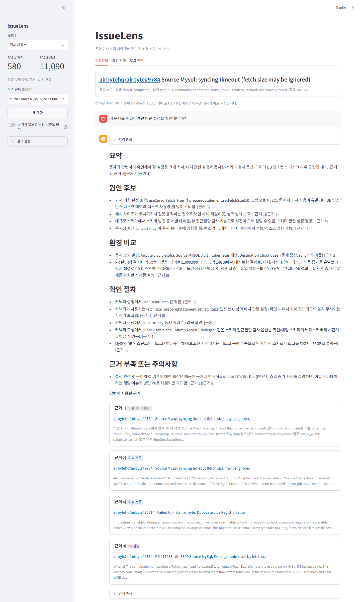
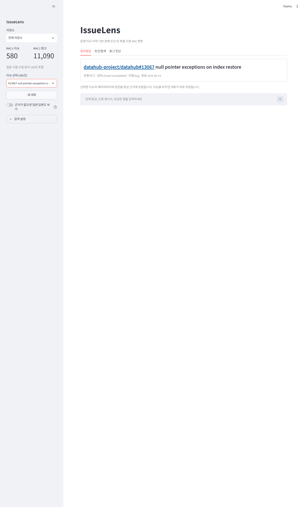
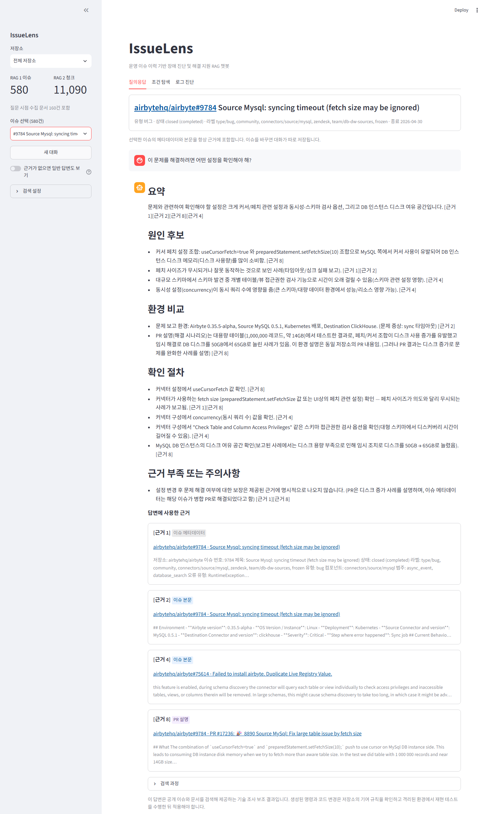
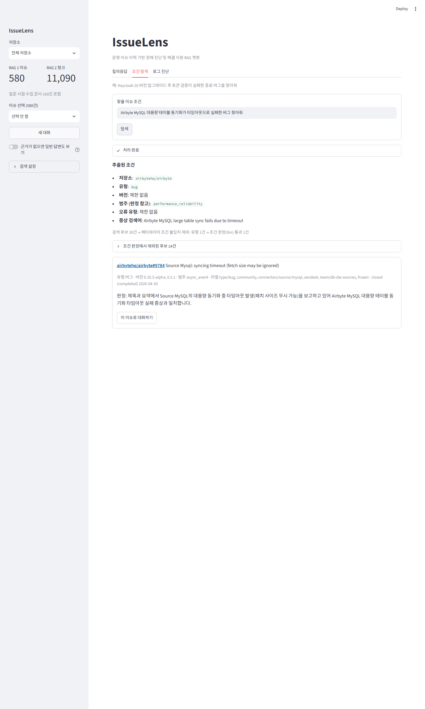
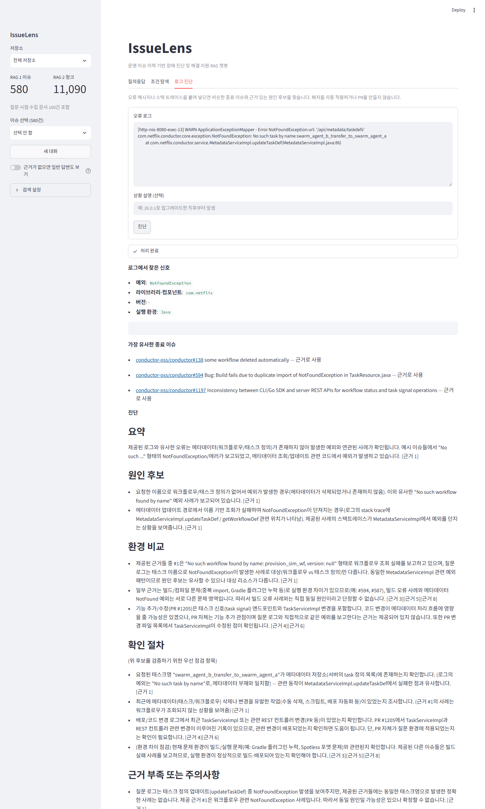
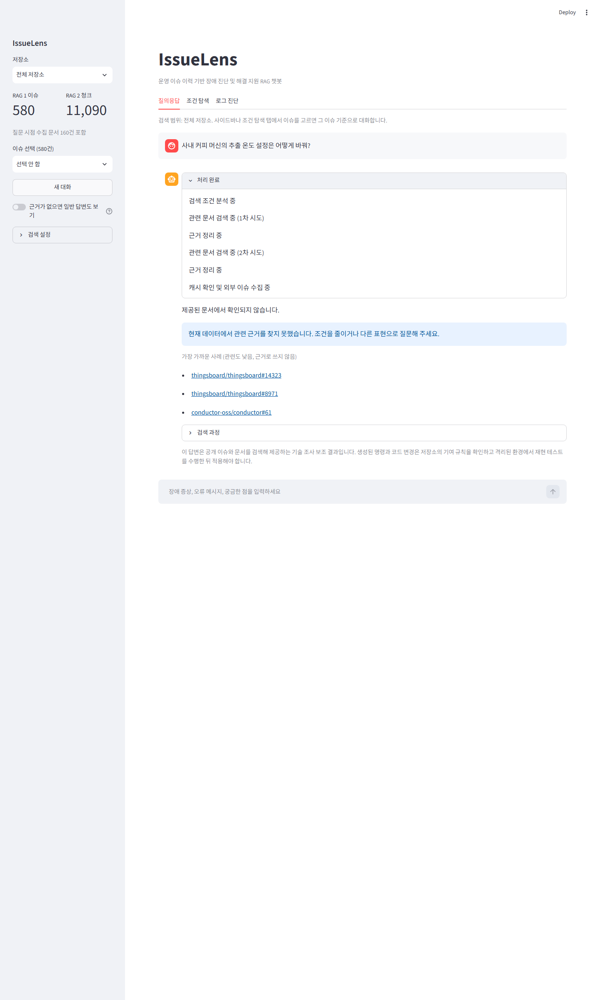
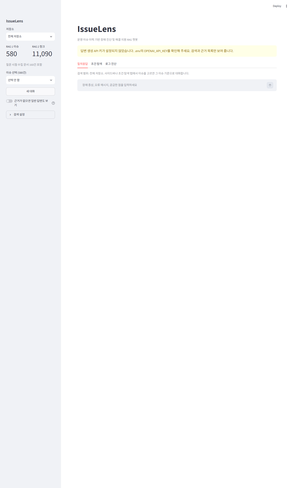
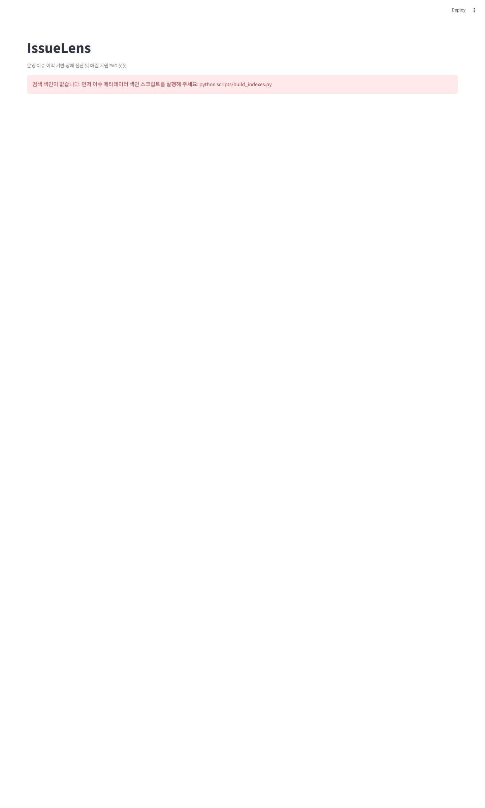
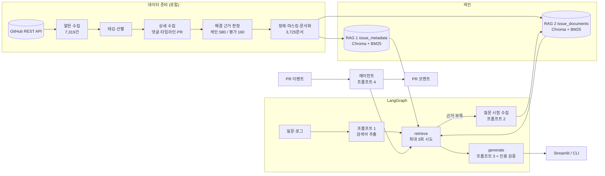

<div align="center">
  <h1>IssueLens</h1>
  <h3>선제적 PR 리뷰 및 장애 진단 에이전트</h3>
  <p>오픈소스 해결 이력 기반 RAG</p>
  <p>
    <a href="docs/IssueLens_기획서.md">기획서</a>
    &nbsp;|&nbsp;
    <a href="docs/rag_design.md">RAG 파이프라인 설계문서</a>
    &nbsp;|&nbsp;
    <a href="docs/requirements_traceability.md">요구사항 대조표</a>
    &nbsp;|&nbsp;
    <a href="docs/evidence_checklist.md">증빙 체크리스트</a>
    &nbsp;|&nbsp;
    <a href="https://github.com/Junsoo-Kim/IssueLens/pull/12#issuecomment-6335825668">에이전트 실제 리뷰 코멘트</a>
  </p>
</div>

> SSAFY AI 코어 프로젝트 2회차 (RAG 기반 도메인 지식 서비스) | 개인 프로젝트
> 기획·데이터 수집 파이프라인·색인·Hybrid 검색·LangGraph RAG·Streamlit 화면·GitHub Action 에이전트 전 과정 단독 수행
> 개발 기간: 2026.10

**목차**

- [프로젝트 소개](#프로젝트-소개)
- [프로젝트 배경](#프로젝트-배경)
- [주요 기능](#주요-기능)
- [기술 스택](#기술-스택)
- [시스템 아키텍처](#시스템-아키텍처)
- [데이터 준비와 색인](#데이터-준비와-색인)
- [실행 방법](#실행-방법)
- [검증 결과](#검증-결과)
- [기술적 도전과제](#기술적-도전과제)
- [데이터 출처와 이용 조건](#데이터-출처와-이용-조건)
- [문서](#문서)

## 프로젝트 소개

IssueLens는 오픈소스 저장소에서 **해결된 이슈, 유지보수자 답변, 해결 PR**을 모아 색인하고, 그 해결 이력을 근거로 **코드가 바뀌는 시점에 문제를 먼저 알려 주고**, 장애가 난 뒤에는 원인 후보와 확인 절차를 답하는 RAG 에이전트입니다. 근거가 없으면 지어내지 않고 근거 없는 지적·답변임을 분명히 구분합니다.

해결 이력을 담은 RAG 코어 하나를 두 가지 방식으로 씁니다.

| 기능 | 언제 | 하는 일 | 범위 |
|---|---|---|---|
| **선제적 PR 리뷰** (GitHub Action) | 코드가 바뀔 때 | PR 변경을 리뷰해 문제 후보마다 라이브러리의 해결된 이슈를 찾아, 근거와 해결 방법을 PR 코멘트로 남김 | **핵심 기능** (요구사항 위에 더한 확장) |
| **장애 진단** (Streamlit, CLI) | 장애가 난 뒤 | 증상·로그를 질문하면 과거 해결 사례를 근거로 원인 후보와 확인 절차를 답함 | **요구사항 검증 대상** (F2001~F2012, NF2001~NF2007) |

두 기능은 같은 수집·색인·검색·근거 판정·생성 로직을 쓰고 데이터만 다릅니다. 장애 진단은 8개 오픈소스 서비스의 이슈로, PR 리뷰는 Python AI·LLM 라이브러리 18개의 이슈로 동작합니다.

> 이 답변은 공개 이슈와 문서를 검색해 제공하는 기술 조사 보조 결과입니다. 생성된 명령과 코드 변경은 저장소의 기여 규칙을 확인하고 격리된 환경에서 재현 테스트를 수행한 뒤 적용해야 합니다.

## 프로젝트 배경

### 장애는 잘못된 사용에서 온다

장애의 상당수는 라이브러리 결함보다 잘못된 설정, 바뀐 기본 동작을 모른 채 한 업그레이드, 문서와 다른 API 사용에서 나옵니다. 이런 문제는 이미 오픈소스 저장소에 "버그 같다"는 이슈로 올라와 유지보수자가 올바른 사용법을 설명하고 닫혀 있는 경우가 많습니다. 해결 방법이 이미 공개돼 있는데도 같은 실수를 한 코드가 리뷰를 통과해 배포된 뒤에야 장애로 드러나 다시 조사됩니다. 그래서 문제가 생긴 뒤 묻는 방식에 더해, **코드가 바뀌는 PR 단계에서 알려진 이슈를 먼저 찾아 알려 주는 것**을 핵심 기능으로 삼았습니다.

### 장애 해결 정보는 흩어져 있다

장애가 나면 개발자는 오류 메시지, 버전, 실행 환경을 확인하고 과거 이슈, 댓글, PR을 여러 경로에서 반복해서 찾습니다. 그런데 실제 해결 정보는 흩어져 있습니다.

- 이슈 제목과 라벨에는 증상만 있고 해결 과정은 댓글에 있습니다.
- 같은 오류라도 버전과 실행 환경에 따라 원인이 다릅니다.
- 해결 코드는 연결된 PR에 있지만 이슈와 명시적으로 연결되지 않은 경우가 있습니다.
- 종료된 이슈가 실제 수정인지, 중복인지, 재현 불가인지, 사용법 문의인지 구분하기 어렵습니다.

그래서 이 프로젝트는 공개 오픈소스 저장소의 종료 이슈를 기업 내부 장애 티켓의 대체 데이터로 써서, 과거 운영 이력을 근거 있는 지식으로 바꾸는 것을 목표로 합니다.

### 왜 근거가 필요한 도메인인가

같은 오류도 버전과 환경에 따라 원인이 달라서, 근거 없이 해결책을 만들면 잘못된 패치나 추가 장애로 이어집니다. 도메인 선택 조건은 다음과 같이 충족합니다.

| 조건 | 충족 근거 |
|---|---|
| 항목 메타데이터 약 100건 이상 | 서로 다른 기술 스택의 8개 오픈소스 서비스에서 종료 이슈 7,319건을 얕게 수집하고, 해결 근거 판정을 거쳐 **580건**을 색인 (평가용 160건은 별도 격리) |
| 항목마다 연결 문서 | 이슈마다 본문, 댓글, 연결 PR 설명, PR 변경 내용을 외부 문서로 수집 (**3,725문서**) |
| 근거가 필요한 질문 | "Keycloak 업그레이드 후 토큰 검증 오류", "DataHub 인덱스 복원 중 NullPointerException"처럼 버전·환경별로 원인이 다른 질문 |
| 위험 도메인 여부 | 건강·금융 판단 도메인은 아님. 대신 모든 답변에 위 기술 조사 보조 안내를 표시 |

## 주요 기능

### 핵심 기능: 선제적 PR 리뷰

Python AI·LLM 프로젝트의 PR이 열리면, 바뀐 코드가 쓰는 라이브러리(OpenAI, LangChain, Pydantic 등 18개)의 해결된 이슈·유지보수자 답변·Discussions 채택 답변을 근거로 리뷰 코멘트를 하나 남깁니다.

```text
PR 변경 파일 -> 비밀정보 마스킹 -> 변경 신호(의존성·import·API 호출·설정) -> 패키지 -> 라이브러리 저장소
  -> 리뷰 후보 추출(프롬프트 4) -> 후보별 3단계 검색·근거 판정(챗봇 RAG 코어 재사용) -> 근거 기반 해결 방법
  -> "알려진 이슈 기반 (RAG)" + "일반 코드 리뷰 (RAG 미사용)" 코멘트 -> 기존 코멘트 갱신 또는 새로 게시
```

- 근거가 있는 지적만 [근거 N]과 원문 링크로 쓰고, 근거가 없는 지적은 "일반 코드 리뷰 (RAG 미사용, 근거 없음)"으로 분리
- 숨은 표식으로 기존 코멘트를 찾아 갱신해 PR당 코멘트는 하나만 유지
- `pull_request` 이벤트만 사용하고 포크 PR은 건너뜀. 권한은 `contents: read`, `pull-requests: write`뿐. patch는 마스킹한 뒤에만 LLM에 넣고, 게시 직전에도 한 번 더 마스킹
- 라이브러리 코퍼스는 Action 캐시에 두고 대상 레포가 쓰는 라이브러리만 실행당 최대 3개씩 구축

실제 동작: 이 레포의 [시연 PR #12](https://github.com/Junsoo-Kim/IssueLens/pull/12)에서 Action이 3분 만에 코퍼스 구축·리뷰·게시를 마치고 [코멘트](https://github.com/Junsoo-Kim/IssueLens/pull/12#issuecomment-6335825668)를 남겼습니다.

### 필수 기능 (F2001~F2012): 장애 진단

| ID | 기능 | 구현 |
|---|---|---|
| F2001 | 항목 메타데이터 적재 | 종료 이슈 1건을 저장소·제목·상태·라벨·유형·컴포넌트·범주·오류 유형·버전·증상 요약·해결 근거를 묶은 색인 텍스트로 구성 |
| F2002 | 메타데이터 색인 (RAG 1) | `issue_metadata` 컬렉션. 결정적 ID와 content hash로 upsert해 재색인해도 개수·ID 불변, 바뀐 레코드만 다시 임베딩 |
| F2003 | 검색어 추출 (프롬프트 1) | 장애 분석가 역할로 한국어 질문에서도 영어 검색어, 정확 토큰(예외명·버전·설정 키), 저장소 후보를 JSON으로 추출 |
| F2004 | 외부 문서 수집 (프롬프트 2) | 근거가 부족하면 GitHub에서 같은 저장소의 종료 이슈를 검색하고, 제목·요약만 보고 고른 이슈만 본문·댓글·PR까지 수집. 같은 검색어는 캐시로 재수집하지 않음 |
| F2005 | 외부 문서 색인 (RAG 2) | `issue_documents` 컬렉션. 문서 유형별 청크 크기·겹침을 `configs/retrieval.yaml`에서 조정 |
| F2006 | 근거 검색과 병합 | 이슈 단위 → 문서 단위 2단계 Hybrid 검색(BM25 + Dense, RRF), 중복 제거, 이슈·유형 다양성 제한. Top-k는 설정으로 조정 |
| F2007 | 근거 기반 답변 (프롬프트 3) | LangGraph `retrieve` → `generate`. 근거 판정을 통과한 경우에만 근거 내용으로 답하고, 아니면 확인되지 않는다고 답함 |
| F2008 | 근거 표시 | 주장마다 [근거 N], 인용 검증으로 없는 번호 제거, 실제 인용한 근거만 원문 URL·출처 유형(이슈 본문/댓글/PR 설명/유지보수자)과 함께 표시 |
| F2009 | 항목 선택과 질의응답 | 사이드바에서 이슈를 고르면 그 이슈의 메타데이터·본문을 항상 근거에 넣고, 이슈마다 대화를 따로 저장 |
| F2010 | 도메인 특화: 로그 진단 | 스택 트레이스에서 예외·라이브러리·버전·환경을 뽑아 유사 종료 이슈와 근거 있는 원인 후보 제시 |
| F2011 | 조건 기반 항목 탐색 | "Airbyte MySQL 대용량 테이블 동기화가 타임아웃으로 실패한 버그 찾아줘" → 조건 추출, 메타데이터 필터, 증상 검색, LLM 조건 판정 후 카드로 제시. 카드를 누르면 그 이슈로 대화 |
| F2012 | 진행 상태와 안내 | 단계별 진행 표시, 색인 없음·키 없음·검색 결과 없음 안내. 키·프롬프트 전문·스택 트레이스는 화면에 표시하지 않음 |

#### 이슈 선택과 질의응답 (F2009)

이슈를 바꾸면 이전 이슈의 대화가 섞이지 않고, 돌아오면 그 이슈의 대화가 그대로 남아 있습니다.

| 이슈 A에서 질문 | 이슈 B로 전환 (대화 비어 있음) | 다시 이슈 A |
|---|---|---|
|  |  |  |

#### 조건 기반 이슈 탐색 (F2011)



#### 로그 진단 (F2010)

색인에서 격리한 평가용 이슈의 실제 로그를 넣어, 답이 새어 들어가지 않은 상태에서 비슷한 다른 이슈를 찾는지 확인했습니다.



#### 진행 상태와 오류 안내 (F2012)

| 처리 단계 · 근거 없음 | API 키 없음 | 색인 없음 |
|---|---|---|
|  |  |  |

### 심화 기능 (F2013~F2016)

심화 과제는 선택하지 않았습니다. 대신 같은 RAG 코어를 다른 입력(PR 변경)과 다른 코퍼스(Python AI·LLM 라이브러리)에 적용한 선제적 PR 리뷰를 만들었습니다(위 핵심 기능).

## 기술 스택

| 분류 | 기술 |
|---|---|
| 언어 | Python 3.10+ |
| LLM·임베딩 | gpt-5-mini (SSAFY GMS, OpenAI 호환), OpenAI `text-embedding-3-small` (1,536차원) |
| RAG | LangChain 1.3.14, langchain-openai 1.4.3, langchain-text-splitters 1.1.2 |
| 파이프라인 | LangGraph 1.2.10 (`retrieve`, `generate` 노드), LangSmith 0.10.17 (선택) |
| 검색 | ChromaDB 1.5.9 (Dense, cosine), rank-bm25 0.2.2 (Sparse, 기술 토큰 전용 토크나이저), Weighted RRF (k=60) |
| UI | Streamlit 1.62.0 |
| 수집 | GitHub REST·GraphQL API, Requests 2.34.2 (ETag 캐시, Rate Limit·재시도) |
| 에이전트 | GitHub Actions (composite action), PyPI JSON API |
| 테스트 | pytest (270개, 가짜 LLM·임베딩·GitHub 응답), Streamlit AppTest, Playwright (화면 캡처 자동화) |

## 시스템 아키텍처



| 폴더 | 역할 |
|---|---|
| `src/collectors/` | GitHub 클라이언트(재시도, Rate Limit, ETag 캐시), 이슈·댓글·타임라인·PR 수집, 질문 시점 수집 |
| `src/preprocessing/` | 정제, 비밀정보 마스킹, 태깅, 해결 근거 판정, 문서 생성 |
| `src/indexing/` | Chroma, BM25, 결정적 ID, 임베딩 |
| `src/retrieval/` | 질의 분석, 저장소 라우팅, Dense·Sparse·RRF, 근거 선별 |
| `src/prompts/` | 프롬프트 1~3, 근거 판정, 조건 탐색, LLM 호출 |
| `src/graph/` | LangGraph `retrieve`, `generate` |
| `src/services/` | 조립, 조건 탐색, 로그 진단, 인용 검증 |
| `src/ui/` | Streamlit 화면 |
| `agent/` | PR 리뷰 에이전트 (변경 수집, 신호, 레지스트리, 코퍼스, 리뷰, 근거 검색, 코멘트) |
| `scripts/` | 수집, 색인, 질의, 검증, 증빙, 캡처 CLI |
| `configs/` | 앱·검색·저장소·에이전트 설정 |

## 데이터 준비와 색인

수집 원본과 색인은 이슈 원문을 담고 있어 **로컬에만 둡니다** (`data/raw`, `data/processed`, `chroma_db`, `sparse_index`, `agent_index`는 `.gitignore`). 저장소에는 원문 없는 manifest(선별 결과, 건수, 라이선스)만 커밋돼 있습니다.

| 단계 | 내용 | 결과 |
|---|---|---|
| 1. 얕은 수집 | 저장소별 최근 종료 이슈 최대 1,000건 (Search API) | 7,319건 |
| 2. 태깅·선별 | 라벨·본문 규칙으로 유형·컴포넌트·범주·품질 점수, 기능 요청·작업·봇 종료 제외 | 상세 수집 대상 800건 |
| 3. 상세 수집 | 본문, 댓글, 타임라인, 연결 PR과 변경 파일 | |
| 4. 해결 근거 판정 | 병합 PR·종료 커밋(strong), 유지보수자 설명(medium) 등으로 판정, 색인/평가/예비 분리 | 색인 580건, 평가 160건 |
| 5. 문서화 | 정제, 비밀정보 마스킹, 봇·잡음 댓글과 생성 파일 제외 | 3,725문서 (본문 580, 댓글 1,965, PR 설명 272, PR 변경 908) |
| 6. 색인 | 문서 유형별 청킹, Chroma(Dense) + BM25(Sparse) | RAG 1 580건, RAG 2 청크 10,520개 |

청크 크기·겹침은 `configs/retrieval.yaml`의 `chunking`에서 바꿉니다 (본문 900/150, 댓글 700/100, PR 설명 800/120, PR 변경 1,200/0). 이렇게 정한 이유와 값을 바꿨을 때의 차이는 [RAG 파이프라인 설계문서](docs/rag_design.md)에 있습니다.

## 실행 방법

### 설치

```bash
python -m venv .venv
source .venv/bin/activate          # Windows Git Bash: source .venv/Scripts/activate
pip install -r requirements.txt
cp .env.example .env               # 키를 채운다 (Git에 올리지 않음)
```

| 변수 | 설명 |
|---|---|
| `GITHUB_TOKEN` | 수집과 질문 시점 수집용. 공개 저장소 읽기 전용 Fine-grained 토큰 권장 |
| `OPENAI_API_KEY`, `OPENAI_BASE_URL` | 채팅·임베딩. 주소는 `/v1`까지만 적습니다 |
| `OPENAI_EMBEDDING_BASE_URL`, `OPENAI_EMBEDDING_API_KEY` | 임베딩 주소·키가 채팅과 다를 때만 |
| `LANGSMITH_TRACING`, `LANGSMITH_API_KEY` | 선택. 키 없이 `true`면 자동으로 끕니다 |

연결 확인: `python scripts/check_openai.py` (키는 출력하지 않습니다)

### 데이터 수집과 색인

```bash
python scripts/collect_issues.py --mode shallow                 # 저장소별 최대 1,000건 얕은 수집
python scripts/tag_and_select.py                                # 태깅, 상세 수집 대상 선별
python scripts/collect_issues.py --mode deep --selection-file data/manifests/deep_selection.jsonl \
    --include-comments --include-timeline --include-linked-prs  # 댓글·타임라인·연결 PR
python scripts/inspect_deep.py                                  # 해결 근거 판정, 색인/평가/예비 분리
python scripts/analyze_scope.py                                 # 범위 확정 점검
python scripts/build_indexes.py                                 # 문서·청크·Chroma·BM25 (바뀐 레코드만 임베딩)
```

수집은 `--resume`으로 중단 지점부터 이어갈 수 있고, 같은 요청은 ETag 캐시로 다시 받지 않습니다.

### 장애 진단 실행 (챗봇)

```bash
streamlit run app.py                                            # 화면 (질의응답, 조건 탐색, 로그 진단)
python scripts/ask.py "sync job fails with timeout on large MySQL tables"
python scripts/ask.py "이 문제 다른 버전에도 있나요?" --issue airbytehq/airbyte#9784
python scripts/ask.py "..." --allow-general                     # 근거가 없으면 RAG 미사용 일반 답변도 표시
python scripts/ask.py --graph                                   # LangGraph 구조 (Mermaid)
```

### 선제적 PR 리뷰 실행

```bash
python scripts/build_agent_corpus.py --repo openai/openai-python     # 라이브러리 코퍼스 구축 (agent_index/)
python -m agent.main --diff changes.patch --dry-run                  # 로컬 diff 리뷰 (게시하지 않고 출력)
python -m agent.main --pr owner/repo#12 --dry-run                    # 실제 PR 리뷰
```

GitHub Action으로 쓰려면 [워크플로 예시](docs/issuelens_review_workflow.yml)를 대상 레포의 `.github/workflows/`에 복사하고 secrets에 `OPENAI_API_KEY`(필수), `OPENAI_BASE_URL`(선택)을 넣습니다. 리뷰 설정은 대상 레포의 `.github/issuelens.yml`로 바꿀 수 있습니다(`exclude_paths`, `max_general_findings`, `general_review` 등).

## 검증 결과

| 명령 | 내용 | 결과 |
|---|---|---|
| `pytest` | 단위·통합·화면(AppTest) 테스트. 가짜 LLM·임베딩·GitHub 응답 | **270개 통과** |
| `python scripts/run_eval.py` | 검증 질문 세트 17개 (근거 있음, 로그 진단, 근거 없음, 조건 탐색, 선택 이슈) | **PASS 16 / FAIL 1** |
| `python scripts/export_evidence.py` | 요구사항 정의서 4장 증빙 중 명령 출력 항목 | 13개 항목 PASS |
| `python scripts/capture_ui.py` | 화면 항목(10~13) 자동 조작·캡처 | 7장 |
| `python scripts/verify_idempotency.py` | 재색인 전후 개수·ID 집합 불변 | PASS |
| `python scripts/run_agent_checks.py` | 에이전트 검증 PR 세트 9개 dry-run | PASS 7 / WARN 1 / FAIL 1 → 수정 후 해당 사례 재실행 PASS |

검증 질문 세트 결과 (`run_eval.py`)

| 유형 | 결과 | 비고 |
|---|---|---|
| 근거 있는 질문 5개 | 5 / 5 | 한국어 질문(q02)은 영어 재작성 검색어로, q05는 질문 시점 수집 후 근거 확보 |
| 로그 진단 5개 | 4 / 5 | q09 실패: ThingsBoard 로그에 다른 제품(Conductor) 이슈를 함께 인용 |
| 근거 없는 질문 3개 | 3 / 3 | 색인에서 격리한 평가용 이슈, 범위 밖 질문(iOS 푸시, 프린터) 모두 답변 거부 |
| 조건 탐색 2개 | 2 / 2 | 조건에 맞는 이슈만 제시, 없는 조건은 0건 |
| 선택 이슈 대화 2개 | 2 / 2 | 선택 이슈의 본문과 해결 PR 인용 |

요구사항별 구현 위치와 증빙은 [요구사항 대조표](docs/requirements_traceability.md)와 [증빙 체크리스트](docs/evidence_checklist.md)에 정리했습니다.

## 기술적 도전과제

### 1. 근거 없는 답변을 막는 3단계 검색과 근거 판정

**문제 상황**

처음 구현은 검색 결과를 그대로 답변에 넣었습니다. 그러자 질문과 단어만 겹친 다른 이슈의 PR을 "해결 근거"로 세어 그럴듯한 답을 만들었습니다. 반대로 한국어 질문은 영어 이슈와 표현이 달라 관련 이슈가 있는데도 근거를 찾지 못했습니다.

**설계와 구현**

- **시도마다 근거를 판정하고 다음 단계로 넘어가기**: `retrieve`가 ① 원래 질문 → ② 프롬프트 1의 영어 검색어 → ③ GitHub에서 관련 이슈를 수집·색인한 뒤 재검색의 순서로 최대 3번 검색합니다. 시도마다 근거 판정을 하고, 충분하면 멈춥니다.
- **규칙 판정과 LLM 판정의 분리**: 근거가 0건이거나 질문의 정확 토큰(예외명, 버전, 설정 키)이 어느 근거에도 없으면 LLM을 부르지 않고 부족으로 봅니다. 재작성 검색어와 수집 후 검색도 원래 질문의 토큰으로 판정해, 영어 검색어에 예외명이 빠진 시도가 이 규칙을 피해 가지 않게 했습니다. 규칙을 통과하면 LLM이 근거만으로 의미 있는 답이 가능한지 관련 근거 번호와 함께 판정합니다.
- **답변 단계의 이중 확인**: 판정을 통과해도 답변 프롬프트가 "근거가 질문과 직접 맞지 않으면 확인되지 않는다고 답한다"를 지키게 하고, 인용 검증으로 없는 근거 번호를 지웁니다.
- **평가용 이슈 격리**: 평가용 이슈 160건은 색인과 질문 시점 수집 모두에서 뺐습니다. 그 이슈의 로그로 진단하면 정답 이슈가 근거로 새어 들어가지 않은 상태에서 비슷한 다른 사례를 찾는지 볼 수 있습니다.

**검증 결과**

| 항목 | 결과 |
|---|---|
| 근거 없는 질문 거부 | 3 / 3 (평가용 이슈의 오류, 범위 밖 질문 2개) |
| 질문 시점 수집으로 근거 확보 | q05, q07: 1·2차 시도 부족 → 3차 수집 후 근거 기반 답변 |
| 같은 질문 재실행 | GitHub 검색 0회, 검색어 캐시 적중 (NF2002) |
| 남은 문제 | q09: 3차 수집 후 검색에서 저장소를 하나로 좁히지 못해 다른 제품 근거가 섞임 → 수집한 저장소로 검색 범위를 한정하는 개선 예정 |

### 2. 기술 토큰과 한국어 질문을 함께 다루는 Hybrid 검색

**문제 상황**

장애 질문에는 `TokenVerificationException`, `26.0.1`, `KC_HOSTNAME`처럼 정확히 일치해야 하는 토큰과 "업그레이드 후 로그인이 안 돼요" 같은 자연어가 섞여 있습니다. Dense 검색만으로는 정확 토큰을 놓치고, BM25만으로는 한국어 질문과 영어 이슈를 잇지 못했습니다. 또 `NotFoundException이`처럼 한국어 조사가 붙으면 정규식의 `\b` 경계가 한글을 단어 문자로 보아 예외명을 뽑지 못했습니다.

**설계와 구현**

- **2단계 Hybrid 검색**: 이슈 단위(RAG 1)로 BM25와 Dense를 각각 검색해 Weighted RRF(k=60)로 합친 뒤, 상위 이슈로 범위를 좁혀 문서 단위(RAG 2)에서 같은 방식을 반복합니다. 질의 유형(오류 로그, 자연어, 조건 탐색)마다 BM25와 Dense의 가중치를 다르게 둡니다.
- **기술 토큰 전용 토크나이저**: 점·밑줄·하이픈이 든 토큰은 원형을 지우지 않고 부분 토큰을 추가해, `io.grpc.StatusRuntimeException`과 `StatusRuntimeException`이 모두 걸리게 했습니다.
- **한국어 조사 경계**: 질의 분석의 패턴만 영문·숫자 기준 경계(`(?<![A-Za-z0-9_])`)로 바꿨습니다. 색인 쪽 태깅은 그대로 둬 재임베딩이 필요 없었습니다.
- **질문 시점 수집 검색어**: GitHub 검색은 모든 단어가 들어간 이슈만 돌려줘 긴 문장 검색어는 0건이 되기 쉽습니다. 정확 토큰을 하나씩 검색어로 만들고, 흔한 예외명은 뒤로 미루고, 스택 트레이스의 예외 발생 클래스를 맨 앞에 둡니다.

**검증 결과**

| 항목 | 결과 |
|---|---|
| 한국어 질문(q02 "동기화 작업이 대용량 테이블에서 타임아웃으로 실패해") | 원래 질문 부족 → 영어 재작성 검색어로 영어 질문(q01)과 같은 이슈 인용 |
| Top-k 변경(이슈 8/근거 8 → 3/4) | 근거 7건 → 4건. 해결 근거 자리를 따로 잡아 유지보수자 댓글은 남음 |
| 청크 크기·겹침 절반 | 청크 10,520개 → 19,465개 |

### 3. PR 리뷰 에이전트의 해결 근거 판정과 오탐 줄이기

**문제 상황**

라이브러리 저장소의 종료 이슈를 그대로 쓰면 근거가 되지 않는 이슈가 대부분이었습니다. LangChain은 상세 수집한 40건이 모두 해결 근거 없음으로 탈락했습니다. 실제 PR로 검증하자 문서만 바꾼 PR에 README 지적 4건이 나왔고, 1.x에서 없어진 `openai.ChatCompletion`을 옛 사용 예를 근거로 "유효하다"고 판정하기도 했습니다.

**설계와 구현**

- **해결 유형 세 가지**: `fix`(병합 PR·종료 커밋·유지보수자 해결 설명), `usage`(질문·not_planned로 닫혔지만 유지보수자가 원인이나 올바른 사용법을 설명), `discussion`(Discussions 채택 답변, GraphQL)만 근거로 인정합니다.
- **진단 스크립트로 원인 찾기**: 받아 둔 원본만으로 이슈마다 판정 근거를 출력하는 `diagnose_agent_corpus.py`를 만들어 원인을 확인했습니다. 20건은 triage 봇이 일괄 종료한 이슈였고, 19건은 유지보수자가 길게 설명했지만 단어 신호가 없어 탈락한 이슈였습니다. 그래서 후보 순서를 "댓글이 오간 이슈 우선"으로 바꾸고, 200자 이상이거나 코드·링크가 있는 유지보수자 댓글을 설명으로 인정했습니다.
- **오탐 줄이기**: 리뷰 대상을 `.py`·의존성·설정 파일로 한정했습니다. 프롬프트 4의 정확 토큰은 근거에 실제로 나올 형태로 정리합니다(`request_timeout=5` → `request_timeout`, `model` 같은 흔한 이름 제거). 근거 판정 질문에는 "근거가 같은 API를 쓰는 사례일 뿐 우려를 뒷받침하지 않으면 답할 수 없다"는 기준을 넣었습니다.
- **보안 검증에서 찾은 빈틈**: 가짜 키가 든 patch로 테스트하다가, LLM 입력은 마스킹됐지만 LLM이 만든 문장이 그대로 코멘트에 들어갈 수 있다는 것을 발견했습니다. 게시 직전에 한 번 더 마스킹하고 @멘션을 끊도록 고쳤습니다.

**검증 결과**

| 항목 | 결과 |
|---|---|
| LangChain 코퍼스 판정 | 40건 중 0건 → 37건 중 20건 통과 (상세 수집 450건 중 143건 색인) |
| 구축한 코퍼스 | openai-python 150건(Discussions 23), langchain 143건, pydantic 150건(Discussions 50) |
| 검증 PR 세트 9개 | PASS 7 / WARN 1 / FAIL 1 → 문서만 바꾼 PR(FAIL)과 openai 사례(WARN) 수정 후 재실행 PASS |
| openai 사례 코멘트 | `ChatCompletion` → 유지보수자 댓글(#2401)을 근거로 "v1부터 `client.chat.completions.create`로 옮겨야 함" |
| 실제 GitHub Action | 시연 PR #12에서 3분 만에 코퍼스 구축·리뷰·코멘트 게시 |

## 데이터 출처와 이용 조건

| 저장소 | 이슈 출처 | 저장소 라이선스 (SPDX) |
|---|---|---|
| `datahub-project/datahub` | https://github.com/datahub-project/datahub/issues | Apache-2.0 |
| `open-metadata/OpenMetadata` | https://github.com/open-metadata/OpenMetadata/issues | Apache-2.0 |
| `langgenius/dify` | https://github.com/langgenius/dify/issues | NOASSERTION ([LICENSE](https://github.com/langgenius/dify/blob/main/LICENSE)) |
| `thingsboard/thingsboard` | https://github.com/thingsboard/thingsboard/issues | NOASSERTION ([LICENSE](https://github.com/thingsboard/thingsboard/blob/master/LICENSE)) |
| `conductor-oss/conductor` | https://github.com/conductor-oss/conductor/issues | Apache-2.0 |
| `airbytehq/airbyte` | https://github.com/airbytehq/airbyte/issues | NOASSERTION ([LICENSE](https://github.com/airbytehq/airbyte/blob/master/LICENSE)) |
| `getsentry/sentry` | https://github.com/getsentry/sentry/issues | NOASSERTION ([LICENSE](https://github.com/getsentry/sentry/blob/master/LICENSE)) |
| `keycloak/keycloak` | https://github.com/keycloak/keycloak/issues | Apache-2.0 |

- 데이터는 GitHub REST API로 수집했습니다 (`is:issue is:closed`, 2026-10-21). 저장소별 수집 시각과 라이선스는 `data/manifests/source_manifest.json`에 있습니다.
- 에이전트 코퍼스는 Python AI·LLM 라이브러리 18개 저장소의 공개 이슈와 Discussions입니다. 목록과 확인 결과는 `configs/agent_corpus.yaml`, `data/manifests/agent_corpus_report.json`에 있습니다.
- **NOASSERTION**: GitHub가 라이선스를 표준 SPDX 식별자로 판별하지 못한 경우입니다 (Dify, ThingsBoard, Airbyte, Sentry). 이 저장소들은 자체 조건이 붙은 라이선스를 쓰므로 위 LICENSE 원문을 확인해야 합니다.
- 저장소의 코드 라이선스가 이슈와 댓글의 사용자 작성 내용에 자동으로 적용된다고 가정하지 않습니다. 이슈와 댓글은 공개 URL, 작성자 계정명, 수집일을 기록하고 교육 목적에 필요한 범위에서만 사용합니다.
- 이슈 원문은 별도 데이터셋으로 재배포하지 않습니다. 이 저장소에는 수집기, 설정, 원문 없는 manifest만 포함합니다. 화면 캡처에는 답변에 인용된 공개 이슈의 짧은 발췌와 원문 링크가 보입니다.
- 답변의 근거에는 항상 원문 URL을 표시합니다.
- 수집 시 사용자 이메일, 아바타 URL, 인증 정보는 저장하지 않고, 본문의 키·토큰·이메일·IP 후보는 마스킹합니다.
- GitHub API는 인증 요청, 순차 호출, 요청 간격(일반 0.5초, 검색 2초), `Retry-After`·`X-RateLimit-Reset` 준수, 지수 백오프, ETag 조건부 요청으로 호출합니다.

## 문서

| 문서 | 내용 |
|---|---|
| [기획서](docs/IssueLens_기획서.md) | 챗봇과 에이전트 전체 설계 (요구사항 정의 포함) |
| [RAG 파이프라인 설계문서](docs/rag_design.md) | 컬렉션 구조, 수집·청킹·색인 흐름, 병합·중복 제거, 프롬프트, 설정값의 이유와 바꿨을 때의 차이 |
| [요구사항 대조표](docs/requirements_traceability.md) | F2001~F2012, NF2001~NF2007의 구현 위치, 테스트, 증빙, 결과 |
| [증빙 체크리스트](docs/evidence_checklist.md) | 요구사항 정의서 4장 항목별 확인 방법과 증빙 파일 |
| [범위 확정](docs/scope.md) | 수집 대상 저장소와 범주 결정 근거 |
| [에이전트 워크플로 예시](docs/issuelens_review_workflow.yml) | 다른 레포에서 PR 리뷰 에이전트를 쓰는 방법 |
